# System Architecture: BrandShield AI — Digital Brand Protection

This document outlines the architectural blueprint, data pipeline, and security design of **BrandShield AI**, an autonomous Digital Risk Protection platform focused on social media and app store impersonation monitoring.

---

## 1. High-Level Architecture Diagram (Mermaid)

```mermaid
flowchart TD
    subgraph ClientLayer ["1. Presentation Layer (React 18 + Vite + Tailwind)"]
        UI_Home["Sectioned Home Page (Hero, Telemetry, How-It-Works, Capabilities, FAQ)"]
        UI_Nav["Sticky Navbar (Brand Switcher, Demo Dataset Badge, Theme Engine)"]
        UI_Dash["Zero-Lag SVG Dashboard (Pure SVG/CSS Charts, Dataset Composition Card)"]
        UI_Ingest["Ingest & Check Workbench (Single Evaluator + Bulk CSV up to 200 rows)"]
        UI_Detect["Detections View (Combinable URL-Synced Filters, 25/page Pagination, CSV Export)"]
        UI_Modal["Threat Analysis Modal (Official vs Candidate Diff, Evidence Points, Checklist)"]
        UI_Lab["Look-alike Name Detection Lab (Homoglyph Folding, Leetspeak, Over-flagging Guard)"]
        UI_Excl["Asset Auditor ('Why Wasn't This Flagged?' Allowlist Transparency)"]
        UI_Feedback["Feedback & Insights Widget (1-5 Stars, Focus Categories, Anti-Spam Honeypot)"]
    end

    subgraph APILayer ["2. API & Routing Layer (Express + TypeScript, 2MB Cap)"]
        R_Health["GET /api/health (status: ok, mode: demo-dataset)"]
        R_Profile["GET/PUT /api/profile & GET /api/profile/brands (Allowlist Management)"]
        R_Scan["POST /api/scan & GET /api/detections (Query Filtering & Single Lookup)"]
        R_Ingest["POST /api/ingest/check & POST /api/ingest/save (Rate-Limited Evaluation Engine)"]
        R_Dataset["GET /api/dataset/counts & POST /api/dataset/reset (Provenance & Safe Reset)"]
        R_Feedback["POST /api/feedback & GET /api/feedback (Honeypot-Protected Feedback)"]
        R_Lab["POST /api/lookalike/test (Live String Mutator)"]
        R_Config["GET/PUT /api/config (Tunable Weights & Thresholds)"]
    end

    subgraph DataLayer ["3. Data Integrity & Storage Engine"]
        VERIFIED_DATA["server/data/verified-brands.json (HDFC Bank, PhonePe, Flipkart)"]
        SYNTHETIC_DATA["server/data/synthetic-test-data.json (Synthetic Test Cases on RFC Domains)"]
        USER_DATA["server/data/user-submitted-data.json (Persisted User Candidates)"]
        FEEDBACK_DATA["server/data/feedbacks.json (Persisted Community Feedback)"]
        CACHE_ENGINE[("In-Memory Storage Engine with Startup Pre-Computation & Auto-Sync")]
    end

    subgraph DetectionEngine ["4. Deterministic Multi-Signal Detection Pipeline"]
        STEP1{"Stage 1: Official Asset Exclusion Allowlist"}
        STEP1_EXCL["Asset Auditor (Zero Risk, Excluded from Threat Alerts)"]
        STEP2["Stage 2: Homoglyph Folding & Normalized Tokenization"]
        STEP3["Stage 3: Jaro-Winkler & Levenshtein String Similarity"]
        STEP4["Stage 4: Perceptual Logo Geometry Match (dHash)"]
        STEP5["Stage 5: Publisher & Developer Identity Verification"]
        STEP6["Stage 6: Scam Signals & Phishing Urgency Heuristics"]
        STEP7["Stage 7: Active-Weight Normalized Score Synthesis (0-100 Score)"]
    end

    subgraph AnalysisService ["5. Deterministic Threat Intelligence Engine"]
        THREAT_ANALYSIS["Deterministic Analysis Service (Evidence Breakdown, Takedown Checklist)"]
    end

    %% Data Connections
    VERIFIED_DATA --> CACHE_ENGINE
    SYNTHETIC_DATA --> CACHE_ENGINE
    USER_DATA --> CACHE_ENGINE
    FEEDBACK_DATA --> CACHE_ENGINE
    CACHE_ENGINE --> DetectionEngine

    %% Pipeline Flow
    DetectionEngine -->|Matches Official Allowlist| STEP1_EXCL
    DetectionEngine -->|Exceeds Threat Threshold| THREAT_ANALYSIS
    THREAT_ANALYSIS --> CACHE_ENGINE

    %% API Routes to Engine
    R_Health --> CACHE_ENGINE
    R_Profile --> CACHE_ENGINE
    R_Scan --> CACHE_ENGINE
    R_Ingest --> DetectionEngine
    R_Dataset --> CACHE_ENGINE
    R_Feedback --> CACHE_ENGINE
    R_Lab --> DetectionEngine

    %% Client to API
    UI_Nav --> R_Health
    UI_Dash --> R_Dataset
    UI_Ingest --> R_Ingest
    UI_Detect --> R_Scan
    UI_Modal --> R_Scan
    UI_Lab --> R_Lab
    UI_Excl --> R_Scan
    UI_Feedback --> R_Feedback
```

---

## 2. Detection Pipeline Sequence & Stage Breakdown

BrandShield AI follows an **Exclusion-First**, multi-signal evaluation methodology to prevent false positives while capturing deceptive impersonation tactics.

### Stage 1: Official Asset Exclusion FIRST (Mandatory Allowlist)
Before any similarity calculations take place:
1. The candidate's handles, URLs, and package identifiers are cross-referenced with the verified `BrandProfile`.
2. Exact matches (e.g. `@HDFC_Bank` on X, `com.snapwork.hdfc` on Google Play) are immediately classified as **Safe / Official** (`riskScore = 0`).
3. These assets are routed to the **Asset Auditor** with human-readable audit justification, ensuring they never appear on threat lists.

### Stage 2: Name Similarity & Homoglyph Normalization
- **Unicode & Leetspeak Folding:** Replaces visual lookalikes (`4` $\rightarrow$ `a`, `0` $\rightarrow$ `o`, `1` $\rightarrow$ `l`, `rn` $\rightarrow$ `m`, `vv` $\rightarrow$ `w`).
- **Spacing Regularization:** Condenses artificial spacing (`P h o n e P e` $\rightarrow$ `phonepe`).
- **Distance Metrics:** Computes Jaro-Winkler prefix similarity and Levenshtein edit distance.
- **Added Suffix/Prefix Analysis:** Identifies coercive tokens (`support`, `care24x7`, `official`, `helpdesk`, `kyc`).

### Stage 3: Multi-Signal Safeguard (Over-Flagging Resistance)
- An account is **never** classified as a brand impersonator based solely on a single attribute (such as an overlapping generic word or lack of a blue checkmark).
- Candidates like local businesses (*Flipkart Stationery & Printing Supplies*) or unrelated products (*PePhone Mobile Covers*) trigger **Sector Keyword Guards** that suppress false-positive scores below threat cutoffs.

### Stage 4: Perceptual Logo Similarity
- Compares visual branding geometry using perceptual image hashing (dHash/pHash).
- Candidates with no logo asset explicitly report `logoSimilarityScore: null` with an explanatory reason rather than an arbitrary default.

### Stage 5: Publisher & Developer Verification (Mobile App Stores)
- Compares claimed developer and publisher names against the authorized corporate entity.
- Discrepancies (e.g. `FastCash FinTech Solutions` instead of `HDFC Bank Ltd.`) trigger immediate high-priority publisher mismatch alerts.

### Stage 6: Scam Signals & Urgency Heuristics
- Evaluates bio descriptions and listing copy for financial fraud markers (`send ₹500 get ₹5000 cashback`, `account blocked within 24 hours if KYC unverified`, `DM for refund`).

### Stage 7: Active-Weight Normalized Score Synthesis
- Automatically normalizes the composite score across active weights (e.g. apps without logos don't get artificially deflated).
- Produces an itemized score breakdown (0–100), severity assignment (Critical, High, Medium, Low), side-by-side evidence table, and rule-based operational response checklist without requiring any third-party AI keys.
